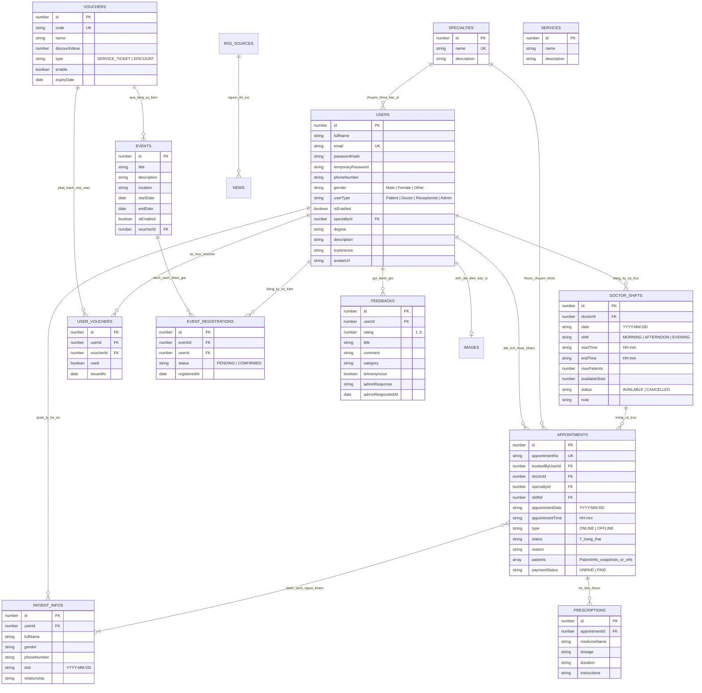
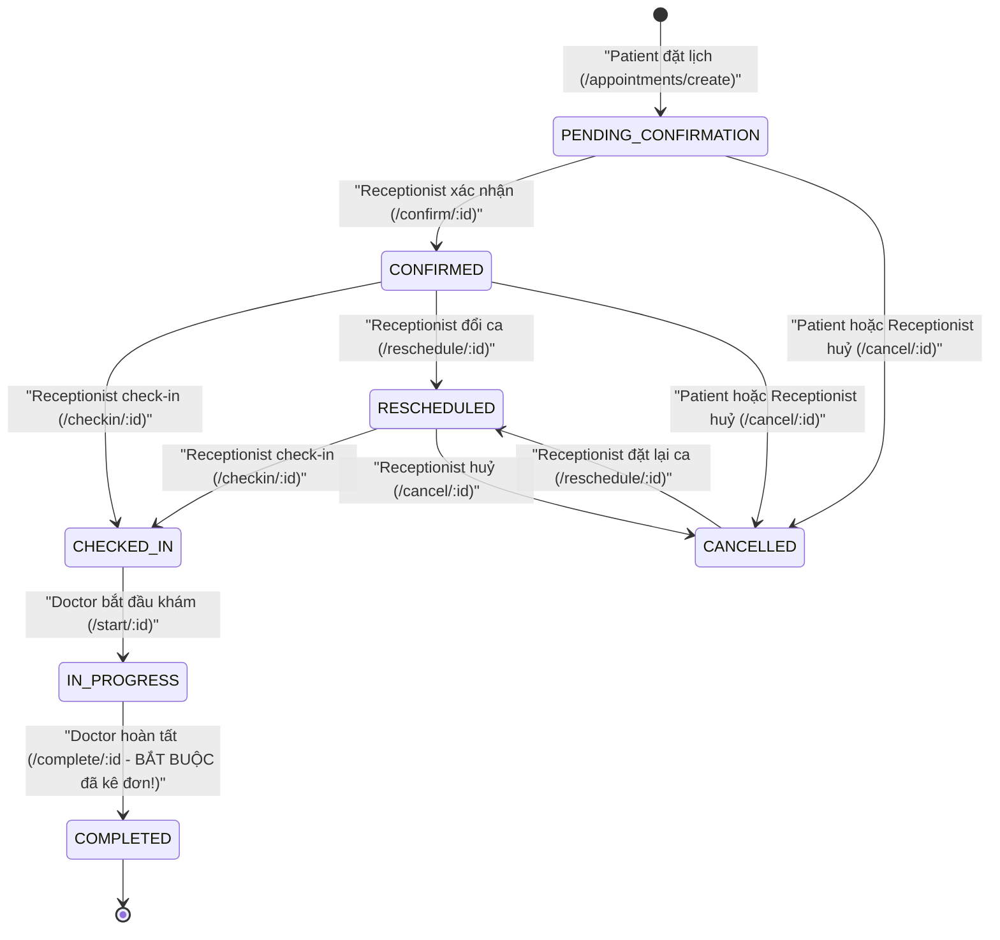

# Phân Tích Cấu Trúc & Dữ Liệu Frontend (`web/`) Chuẩn Bị Phát Triển Backend

Tài liệu này tổng hợp toàn bộ cấu trúc, mô hình dữ liệu, vòng đời trạng thái và danh mục API mà ứng dụng Frontend trong `web/` đang sử dụng, đối chiếu trực tiếp với khung Backend hiện tại (`backend/` — Express 5 + Mongoose 9).

---

## 1. Tổng Quan Kiến Trúc & Hiện Trạng

| Thành phần | Công nghệ hiện tại | Ghi chú quan trọng |
|---|---|---|
| **Web (`web/`)** | React 19, TypeScript, Vite 8, React Router v7, React-Bootstrap 5, Axios | Giao diện đã hoàn thiện đầy đủ cho 5 phân hệ người dùng, gồm 20 module gọi API trong `web/src/api/`. |
| **Backend (`backend/`)** | Node.js (>=20), Express 5.3, Mongoose 9.11 (MongoDB), CORS, Dotenv | Hiện mới chỉ có khung khởi tạo ([app.js](../backend/src/app.js), [db.js](../backend/src/config/db.js)) và duy nhất route `GET /api/health` trong [routes/index.js](../backend/src/routes/index.js). |
| **Mobile (`mobile/`)** | Expo + React Native + TypeScript | Đang ở mức khung khởi tạo cơ bản (`health.service.ts`). |

### Cấu trúc thư mục `web/src/`
- **`api/` (20 files):** Toàn bộ tầng giao tiếp HTTP qua Axios instance chung trong [http.ts](../web/src/api/http.ts).
- **`routes/`:** Định tuyến tập trung tại [Index.tsx](../web/src/routes/Index.tsx) bảo vệ bởi [RequireAuth.tsx](../web/src/routes/_guards/RequireAuth.tsx) và [RequireRole.tsx](../web/src/routes/_guards/RequireRole.tsx).
- **`hooks/useAuth.tsx` & `types/auth.ts`:** Quản lý phiên đăng nhập qua `localStorage["access_token"]` (Bearer JWT) và `localStorage["user"]`.
- **`contexts/AppointmentContext.tsx`:** Lưu trạng thái đặt lịch 4 bước vào `sessionStorage["appt"]`.
- **`pages/`:** Chia theo 6 nhóm: `guest/`, `authentication/`, `appointments/` (`Step1`–`Step4`), `patient/`, `doctor/`, `receptionist/`, `admin/`.

### 5 Vai trò người dùng (`UserType` — Phân biệt chính xác chữ hoa/thường)
Định nghĩa tại [auth.ts](../web/src/types/auth.ts) và kiểm tra nghiêm ngặt ở Route Guard:
- `'Guest'` (chưa đăng nhập)
- `'Patient'` (bệnh nhân — điều hướng về `/` sau khi login)
- `'Doctor'` (bác sĩ — điều hướng về `/doctor/dashboard`)
- `'Receptionist'` (lễ tân — điều hướng về `/receptionist/dashboard`)
- `'Admin'` (quản trị viên — điều hướng về `/admin/dashboard`)

---

## 2. Phát Hiện Quan Trọng: 7 Xung Đột Giữa `web/` và `backend/` (MongoDB)

Code trong `web/` vốn được viết dựa trên đặc tả của một Backend kiểu **Spring Boot + SQL** trước đây. Khi chuyển sang phát triển Backend mới bằng **Express + MongoDB**, có **7 điểm lệch cốt lõi** cần xử lý ngay từ đầu:

> [!WARNING]
> **Xung đột #1 — Kiểu `id: number` trên toàn bộ Frontend vs `ObjectId` của MongoDB:**
> Hầu hết các bộ chuẩn hoá dữ liệu trong `web/src/api/*.ts` và hàng loạt trang ([Appointment.tsx](../web/src/pages/appointments/Appointment.tsx), [Step1.tsx](../web/src/pages/appointments/steps/Step1.tsx), [Step2.tsx](../web/src/pages/appointments/steps/Step2.tsx), [SpecialtyDetail.tsx](../web/src/pages/guest/SpecialtyDetail.tsx), [DoctorAppointment.tsx](../web/src/pages/doctor/DoctorAppointment.tsx), [AddPrescription.tsx](../web/src/pages/doctor/AddPrescription.tsx)) đều ép kiểu `Number(raw.id)` hoặc `parseInt(id, 10)`.
> Nếu Backend trả về `_id` dạng chuỗi hex 24 ký tự của MongoDB (ví dụ `"6720d4a8..."`), `Number(id)` sẽ biến thành `NaN`, làm hỏng toàn bộ tính năng xem chi tiết, lọc chuyên khoa, chọn ca trực và đặt lịch!

**Giải pháp khuyến nghị cho #1:** Tạo collection `counters` trong MongoDB (Mongoose plugin auto-increment) để cấp trường `id: Number` tuần tự (`1, 2, 3...`) cho các bảng, đồng thời dùng `toJSON` trả về `id` kiểu số (hoặc kết hợp sửa nhẹ FE sang `string | number`).

### Các xung đột kỹ thuật còn lại (#2 → #7)

2. **Đồng nhất ID giữa `User`, `Doctor` và `Receptionist` (`user.id === doctor.id`):**
   - Trong [DoctorAppointment.tsx](../web/src/pages/doctor/DoctorAppointment.tsx#L62-L63), FE lấy `user.id` từ `localStorage["user"]` rồi truyền thẳng vào `GET /shifts/by-doctor/${doctorId}`.
   - Trong [AdminDashboard.tsx](../web/src/pages/admin/AdminDashboard.tsx#L48-L58), FE kiểm tra `doctorIds.has(user.id)` và `receptionistIds.has(user.id)` để gắn nhãn vai trò.
   - **Hệ quả thiết kế DB:** `Patient`, `Doctor`, `Receptionist`, `Admin` nên nằm chung trong collection `users` (phân biệt bằng `userType`, kèm các trường mở rộng cho Doctor như `specialtyId`, `degree`, `description`, `experience`), hoặc nếu tách bảng phụ thì trường `id` trả ra cho Doctor/Receptionist bắt buộc phải bằng `user.id`.

3. **Bất đối xứng định dạng ngày giờ ở Sự kiện (`Events`) & Mã giảm giá (`Vouchers`):**
   - Khi tạo/cập nhật tại [AdminEvents.tsx](../web/src/pages/admin/AdminEvents.tsx) và [AdminVouchers.tsx](../web/src/pages/admin/AdminVouchers.tsx), FE format ngày giờ thành chuỗi **`"dd/MM/yyyy HH:mm"`** trước khi gửi lên BE.
   - Ngược lại, khi hiển thị danh sách hoặc đổ vào form sửa, FE gọi trực tiếp `new Date(value)` — hàm này trong JS sẽ trả về `Invalid Date` nếu BE trả lại `"dd/MM/yyyy HH:mm"`!
   - **Yêu cầu BE:** Khi nhận request, parser cần chấp nhận cả `"dd/MM/yyyy HH:mm"` lẫn ISO-8601; khi trả response JSON, luôn trả chuẩn **ISO-8601** (`"2026-10-30T14:30:00.000Z"`).

4. **Không đồng nhất chữ hoa/thường ở trường `gender`:**
   - [Register.tsx](../web/src/pages/authentication/Register.tsx) gửi `'MALE' | 'FEMALE' | 'OTHER'`.
   - [AdminCreateUser.tsx](../web/src/pages/admin/AdminCreateUser.tsx), [PatientProfile.tsx](../web/src/components/patient/PatientProfile.tsx), [Step3.tsx](../web/src/pages/appointments/steps/Step3.tsx) gửi `'Male' | 'Female' | 'Other'`.
   - Bộ lọc bác sĩ ở [SpecialtyDetail.tsx](../web/src/pages/guest/SpecialtyDetail.tsx#L153) so sánh nghiêm ngặt `d.gender === 'Male'` / `'Female'`.
   - **Yêu cầu BE:** Chuẩn hoá đầu vào không phân biệt hoa thường, và trả ra chuẩn `'Male' | 'Female' | 'Other'`.

5. **Đường dẫn bị cắt `/api`, thiếu `web/.env` và thiếu `credentials: true` trong CORS:**
   - File `web/.env` chưa được tạo (chỉ có [web/.env.example](../web/.env.example) cấu hình `VITE_API_URL=http://localhost:3000/api`). Nếu chạy `npm run dev` ngoài Docker mà quên tạo `web/.env`, [http.ts](../web/src/api/http.ts#L3) sẽ fallback nhầm về `http://localhost:8080`.
   - Hàm `getImageFullUrl` trong [image.ts](../web/src/api/image.ts#L46-L52) tự động xoá `/api` khỏi base URL và viết lại `/uploads/...` thành `http://localhost:3000/images/file/uploads/...` (nằm **ngoài** prefix `/api` của Express!).
   - [Login.tsx](../web/src/pages/authentication/Login.tsx#L149-L151) cũng xoá `/api` để redirect OAuth2 sang `http://localhost:3000/oauth2/authorization/google` và `.../facebook`.
   - [useAuth.tsx](../web/src/hooks/useAuth.tsx#L62-L65) và [OAuth2Callback.tsx](../web/src/pages/authentication/OAuth2Callback.tsx#L74-L78) gọi `fetch` với `credentials: 'include'`, nên `cors()` trong [backend/src/app.js](../backend/src/app.js#L10-L17) **bắt buộc phải thêm `credentials: true`**.

6. **Chatbot gửi `Content-Type: text/plain`:**
   - [chatbot.ts](../web/src/api/chatbot.ts#L14-L18) gửi câu hỏi dạng chuỗi thuần (`text/plain`) lên `POST /api/chat/ask` và nhận về chuỗi HTML/text. Trong [backend/src/app.js](../backend/src/app.js) cần bổ sung middleware `express.text()` cho route này.

7. **Thanh toán Online & thiếu route `/payment-result`:**
   - Khi đặt khám `ONLINE` ở [Step4.tsx](../web/src/pages/appointments/steps/Step4.tsx#L166-L177), FE gọi `GET /api/payment/create?appointmentNo=...` để lấy `paymentUrl` (ví dụ VNPay). Comment ghi VNPay sẽ redirect về `/payment-result`, nhưng [Index.tsx](../web/src/routes/Index.tsx) hiện chưa có route `/payment-result`.

---

## 3. Mô Hình Dữ Liệu Suy Diễn Cho MongoDB (ERD)

Dựa trên toàn bộ kiểu dữ liệu và truy vấn từ `web/`, hệ thống gồm **11 thực thể nghiệp vụ chính** (cộng thêm bảng `counters` nếu dùng ID số tự tăng):



---

## 4. Quy Tắc Nghiệp Vụ & Vòng Đời Trạng Thái Quan Trọng

### 4.1. Vòng đời Lịch hẹn (`Appointment Status Lifecycle`)
Frontend ánh xạ trạng thái tại [AppointmentStatus.tsx](../web/src/components/appointment/AppointmentStatus.tsx):



> [!IMPORTANT]
> **4 quy tắc ngầm về Lịch hẹn & Ca trực trong code Frontend:**
> 1. **Ràng buộc hoàn tất khám:** Ở [DoctorAppointment.tsx](../web/src/pages/doctor/DoctorAppointment.tsx#L253-L256), nút `Complete` bị khoá cho đến khi `GET /prescriptions/by-appointment/:id` trả về ít nhất 1 đơn thuốc.
> 2. **Ràng buộc hiển thị lịch sắp tới của Bệnh nhân:** [PatientAppointments.tsx](../web/src/pages/patient/PatientAppointments.tsx#L10) chỉ hiển thị các lịch có trạng thái `PENDING_CONFIRMATION`, `CONFIRMED`, `CHECKED_IN`. Nếu lễ tân đổi lịch (`reschedule`), Backend nên đặt lại trạng thái là `CONFIRMED` (hoặc nếu dùng `RESCHEDULED` thì cần lưu ý bệnh nhân sẽ không thấy trên tab Sắp tới nếu không sửa FE).
> 3. **Khung giờ Ca trực (`DoctorShifts.tsx`):** Lịch tuần của bác sĩ xếp lịch hẹn vào ô lưới bằng cách đọc giờ `appointmentTime` (`"HH:mm"`):
>    - `MORNING`: `08:00` – `11:59`
>    - `AFTERNOON`: `13:00` – `16:59`
>    - `EVENING`: `18:00` – `20:59`
>    Nếu `appointmentTime` rỗng hoặc nằm ngoài các khung giờ này, lịch hẹn sẽ **bị ẩn khỏi bảng lịch tuần của bác sĩ**!
> 4. **Bắt buộc trả về `appointmentNo`:** Khi tạo lịch hẹn (`POST /appointments/create`), [Step4.tsx](../web/src/pages/appointments/steps/Step4.tsx#L148-L151) kiểm tra `res.data.appointmentNo` — nếu thiếu sẽ báo lỗi thất bại ngay cả khi lưu DB thành công.

### 4.2. Nghiệp vụ Sự kiện kết hợp Voucher (`Events` + `Vouchers`)
1. **Admin** tạo `Voucher` (`SERVICE_TICKET` hoặc `DISCOUNT`) và tạo `Event` gắn `voucherId` tuỳ chọn.
2. **Patient** xem danh sách sự kiện đang mở (`GET /events`) và bấm đăng ký (`POST /events/:eventId/register`) -> tạo bản ghi `event_registrations` với `status: "PENDING"`.
3. **Receptionist** mở danh sách người đăng ký (`GET /reception/events`) và bấm xác nhận tham dự (`POST /reception/events/:eventId/confirm/:userId`) -> chuyển `status` thành `"CONFIRMED"`. Nếu sự kiện có gắn `voucherId`, hệ thống tự động cấp `UserVoucher` cho `userId` đó!
4. **Patient** xem voucher của mình tại `GET /vouchers/my`; **Receptionist** tra cứu người dùng (`GET /users/search?keyword=...`) và bấm áp dụng/gạch voucher (`POST /vouchers/:voucherId/use?userId=...`).

### 4.3. Nghiệp vụ Quên mật khẩu (`Forgot` / `Reset Password`)
Khác với luồng gửi link token thông thường, [auth.ts](../web/src/api/auth.ts#L68-L104) thiết kế theo luồng **Mật khẩu tạm (Temporary Password)**:
1. `POST /auth/forgot-password` (`{ email }`): Backend sinh mật khẩu ngẫu nhiên tạm thời, lưu vào user và gửi qua email.
2. `POST /auth/reset-password` (`{ email, temporaryPassword, newPassword, confirmPassword }`): Backend đối chiếu `temporaryPassword`, nếu khớp và `newPassword === confirmPassword` thì cập nhật mật khẩu chính thức và xoá mật khẩu tạm.

---

## 5. Chuẩn Định Dạng Response & Error Của API

Để tương thích đồng thời với mọi hàm `pickArray`, `pickObject`, `extractData` và Interceptor trong `web/src/api/`:

- **Response thành công chuẩn nhất (khuyên dùng thống nhất cho toàn bộ Backend):**
  ```json
  {
    "success": true,
    "message": "Thành công",
    "data": { ... } // hoặc [ ... ]
  }
  ```
  *(Ngoại lệ lưu ý:*
  - `POST /api/chat/ask`: trả về chuỗi text/HTML thuần hoặc string JSON vì FE đọc `response.data` kiểu `string`.
  - `GET /api/payment/create`: trả về `{ "paymentUrl": "https://..." }` ở top-level vì `Step4.tsx` đọc `paymentRes.data?.paymentUrl`.
  - `GET /api/images/doctor/:doctorId`, `POST`, `PUT`: trả trực tiếp `{ "id": 1, "imageUrl": "/uploads/doctors/..." }` ở top-level vì `image.ts` đọc `res.data as Image`.
  - `GET /api/auth/oauth2/user-info`: trả `{ "token": "...", "user": { ... } }` ở top-level.)
- **Response lỗi:** Đã khớp sẵn với [error.middleware.js](../backend/src/middlewares/error.middleware.js) hiện tại của bạn (`{ success: false, message: "..." }`), vì [http.ts](../web/src/api/http.ts#L23-L27) ưu tiên đọc `axiosError.response.data.message`.
- **Cấu trúc JWT Claims cần đóng gói khi ký Token:**
  Để tương thích với bộ giải mã tại [OAuth2Callback.tsx](../web/src/pages/authentication/OAuth2Callback.tsx#L24-L27), payload của JWT nên chứa:
  ```json
  {
    "userId": 1,
    "sub": "user@example.com",
    "role": "Patient"
  }
  ```

---

## 6. Danh Mục Toàn Bộ API Endpoints Cần Phát Triển (>60 Endpoints)

*(Giả định `VITE_API_URL=http://localhost:3000/api` — các đường dẫn dưới đây tính tương đối sau `/api`, trừ các route đánh dấu **[Root]** nằm ngoài `/api`)*

### 6.1. Xác thực & OAuth2 (`auth.ts`, `Login.tsx`, `OAuth2Callback.tsx`, `useAuth.tsx`)
| Method | Endpoint | Quyền | Request Body / Query | Response `data` mong đợi |
|---|---|---|---|---|
| `POST` | `/auth/login` | Public | `{ email, password }` | `{ id, fullName, role, token, success: true, message }` |
| `POST` | `/auth/register` | Public | `{ fullName, email, phoneNumber, password, gender? }` | `{ id, email }` (mặc định `userType: 'Patient'`) |
| `POST` | `/auth/register-admin` | Public/Setup | `{ fullName, email, phoneNumber, password, gender? }` | `{ id, email }` (`userType: 'Admin'`) |
| `POST` | `/auth/forgot-password` | Public | `{ email }` | `{ message }` (gửi email mật khẩu tạm) |
| `POST` | `/auth/reset-password` | Public | `{ email, temporaryPassword, newPassword, confirmPassword }` | `{ message }` |
| `POST` | `/auth/change-password` | Auth | `{ email, oldPassword, newPassword, confirmPassword }` | `{ message }` |
| `POST` | `/auth/oauth2/logout` | Public/Auth | *(Cookie/Session)* | `200 OK` |
| `GET` | `/auth/oauth2/user-info` | Public/Auth | *(Cookie/Session fallback)* | **Top-level:** `{ token, user: { id, fullName, email, userType } }` |
| `GET` | **[Root]** `/oauth2/authorization/google` | Public | *(Browser Redirect)* | Redirect sang Google -> callback về FE `/oauth2/callback?token=...` |
| `GET` | **[Root]** `/oauth2/authorization/facebook` | Public | *(Browser Redirect)* | Redirect sang Facebook -> callback về FE `/oauth2/callback?token=...` |

### 6.2. Tài khoản cá nhân & Hồ sơ bệnh nhân (`user.ts`, `patient.ts`)
| Method | Endpoint | Quyền | Request Body / Query | Response `data` mong đợi |
|---|---|---|---|---|
| `GET` | `/users/me` | Auth | — | `{ id, fullName, email, phoneNumber, gender, userType }` |
| `PUT` | `/users/update` | Auth | `{ fullName?, phoneNumber?, gender? }` | `{ id, fullName, email, phoneNumber, gender, userType }` |
| `GET` | `/users/search` | Receptionist, Admin | `?keyword=...` | `[{ id, fullName, email, phoneNumber }]` |
| `GET` | `/patients-info/my` | Patient | — | `[{ id, fullName, gender, phoneNumber, dob, relationship }]` |
| `GET` | `/patients-info/:id` | Auth | — | `{ id, fullName, gender, phoneNumber, dob, relationship }` |
| `POST` | `/patients-info/create` | Patient | `{ fullName, gender?, phoneNumber?, dob?, relationship }` | `PatientInfo` vừa tạo |
| `PUT` | `/patients-info/update/:id` | Patient | `Partial<CreatePatientInfoPayload>` | `PatientInfo` sau cập nhật |
| `DELETE` | `/patients-info/delete/:id` | Patient | — | `200 OK` |

### 6.3. Quản trị Người dùng, Bác sĩ & Lễ tân (`admin.ts`, `doctor.ts`, `receptionist.ts`)
| Method | Endpoint | Quyền | Request Body / Query | Response `data` mong đợi |
|---|---|---|---|---|
| `GET` | `/admin/users` | Admin, Receptionist* | — | Danh sách user đang kích hoạt (`AdminUser[]`) |
| `GET` | `/admin/doctors` | Admin, Public* | — | Danh sách bác sĩ (`Doctor[]` — trang `Doctors.tsx` của Guest cũng gọi hàm này!) |
| `GET` | `/admin/receptionists` | Admin | — | Danh sách lễ tân (`AdminUser[]`) |
| `GET` | `/admin/patients` | Admin | — | Danh sách bệnh nhân (`AdminUser[]`) |
| `GET` | `/admin/all-including-disabled` | Admin | — | Toàn bộ user kể cả bị khoá |
| `GET` | `/admin/disabled` | Admin, Receptionist* | — | Danh sách user đang bị khoá (`isEnabled: false`) |
| `POST` | `/admin/create-user` | Admin | `{ fullName, email, phoneNumber, password, gender, userType: "Doctor"\|"Receptionist", specialization?, degree?, description?, experience? }` *(Lưu ý: `specialization` gửi tên chuyên khoa!)* | `User / Doctor / Receptionist` vừa tạo |
| `PUT` | `/admin/update-doctor/:id` | Admin | `{ fullName?, phoneNumber?, gender?, specialtyId?, degree?, description?, experience? }` | `Doctor` sau cập nhật |
| `DELETE` | `/admin/users/:userId` | Admin, Receptionist* | — | Khoá tài khoản (`isEnabled = false`) |
| `POST` | `/admin/activate/:userId` | Admin, Receptionist* | — | Mở khoá tài khoản (`isEnabled = true`) |
| `GET` | `/doctors/by-specialty/:specialtyId` | Public | — | `Doctor[]` thuộc chuyên khoa |
| `GET` | `/doctors/:id` | Public | — | `Doctor` (bắt buộc kèm `specialtyId` và `specialtyName`!) |
| `GET` | `/doctors/search` | Public | `?keyword=...` | `Doctor[]` |
| `GET` | `/receptionists/all` | Admin | — | `Receptionist[]` |
| `GET` | `/receptionists/:id` | Admin | — | `Receptionist` |
| `PUT` | `/receptionists/update/:id` | Admin | `{ fullName?, phoneNumber?, gender? }` | `Receptionist` |

> [!NOTE]
> Các endpoint đánh dấu `*` ở bảng trên: Trang khách vãng lai ([Doctors.tsx](../web/src/pages/guest/Doctors.tsx) & [DoctorsSection.tsx](../web/src/components/home/DoctorsSection.tsx)) gọi `fetchDoctorsAll()` (`GET /admin/doctors`), và trang Lễ tân ([RecepDashboard.tsx](../web/src/pages/receptionist/RecepDashboard.tsx)) gọi `/admin/users`, `/admin/disabled`, `/admin/users/:id`, `/admin/activate/:id` để quản lý bệnh nhân. Vì vậy Middleware phân quyền ở Backend cần cho phép **Public** đọc `GET /admin/doctors` và cho phép **Receptionist** thao tác khoá/mở khoá Patient trên các route đó!

### 6.4. Chuyên khoa, Dịch vụ & Ảnh (`specialty.ts`, `services.ts`, `image.ts`)
| Method | Endpoint | Quyền | Request Body / Query | Response mong đợi |
|---|---|---|---|---|
| `GET` | `/specialties/all` | Public | — | `[{ id, name, description }]` |
| `POST` | `/specialties/create` | Admin | `{ name, description }` | `{ id, name, description }` |
| `PUT` | `/specialties/update/:id` | Admin | `{ name, description }` | `{ id, name, description }` |
| `GET` | `/services/all` | Public | — | `[{ id, name, description }]` |
| `GET` | `/services/:id` | Public | — | `{ id, name, description }` |
| `GET` | `/images/doctor/:doctorId` | Public | — | **Top-level:** `{ id, imageUrl, doctorId }` (hoặc `404` nếu chưa có ảnh) |
| `POST` | `/images/doctor/:doctorId` | Admin | `multipart/form-data` (`file`) | **Top-level:** `{ id, imageUrl, doctorId }` |
| `PUT` | `/images/doctor/:doctorId` | Admin | `multipart/form-data` (`file`) | **Top-level:** `{ id, imageUrl, doctorId }` |
| `DELETE` | `/images/doctor/:doctorId` | Admin | — | `200 OK` |
| `GET` | **[Root]** `/images/file/uploads/*` | Public | — | Trả file ảnh tĩnh (do `getImageFullUrl` viết lại URL sang đường dẫn này) |

### 6.5. Ca trực Bác sĩ (`shift.ts`)
| Method | Endpoint | Quyền | Request Body / Query | Response `data` mong đợi |
|---|---|---|---|---|
| `GET` | `/shifts/my` | Doctor | `?week=current\|next` (tuỳ chọn) | `DoctorShift[]` của bác sĩ đang đăng nhập |
| `POST` | `/shifts/create` | Doctor | `{ date, shift: "MORNING"\|"AFTERNOON"\|"EVENING", maxPatients?, note?, repeatWeekly?, repeatCount? }` | `DoctorShift` (hỗ trợ lặp hàng tuần tối đa 3 tuần nếu `repeatWeekly=true`) |
| `GET` | `/shifts/admin/week` | Admin | `?start=YYYY-MM-DD&end=YYYY-MM-DD` | `[{ id, date, shiftType, doctorId, doctorName, specialtyName }]` |
| `GET` | `/shifts/by-doctor/:doctorId` | Public / Auth | `?date=YYYY-MM-DD` | `DoctorShift[]` (kèm `availableSlots` hoặc `slots[]`, `startTime`, `endTime`) |
| `GET` | `/shifts/by-date` | Receptionist, Admin | `?date=YYYY-MM-DD` | `DoctorShift[]` kèm `doctorName`, `specialtyName` |

### 6.6. Đặt lịch khám, Vận hành Lịch hẹn, Đơn thuốc & Thanh toán (`appointment.ts`, `prescription.ts`, `Step4.tsx`)
| Method | Endpoint | Quyền | Request Body / Query | Response `data` mong đợi |
|---|---|---|---|---|
| `POST` | `/appointments/create` | Patient | Query: `?specialtyId=...&doctorId=...`<br/>Body: `{ appointment: { reason, type: "ONLINE"\|"OFFLINE" }, shiftId, patients: [...] }` | `Appointment` (**bắt buộc có `appointmentNo`**) |
| `GET` | `/appointments/my-upcoming` | Patient | — | `Appointment[]` sắp tới của bệnh nhân |
| `GET` | `/appointments/my-completed` | Patient | — | `Appointment[]` đã hoàn tất của bệnh nhân |
| `GET` | `/appointments/status/:status` | Doctor, Receptionist, Admin | `?date=YYYY-MM-DD` (tuỳ chọn). Lưu ý `:status` có thể là `"ALL"` (từ `doctorDashboard.ts` — lọc theo bác sĩ đang login nếu role là Doctor!) | `Appointment[]` |
| `GET` | `/appointments/by-date` | Receptionist, Admin | `?date=YYYY-MM-DD` | `Appointment[]` |
| `GET` | `/appointments/by-shift/:shiftId` | Doctor, Receptionist, Admin | — | `Appointment[]` thuộc ca trực |
| `GET` | `/appointments/:id` | Auth | — | Chi tiết `Appointment` (kèm `patients[]`, `doctorId`, `doctorName`, `specialtyName`) |
| `PUT` | `/appointments/confirm/:id` | Receptionist, Admin | — | Chuyển sang `CONFIRMED` |
| `PUT` | `/appointments/checkin/:id` | Receptionist, Admin | — | Chuyển sang `CHECKED_IN` |
| `PUT` | `/appointments/cancel/:id` | Patient, Receptionist, Admin | — | Chuyển sang `CANCELLED` (hoàn lại slot ca trực) |
| `PUT` | `/appointments/reschedule/:id` | Receptionist, Admin | `?newShiftId=...` | Đổi ca trực & cập nhật ngày/giờ |
| `PUT` | `/appointments/start/:id` | Doctor | — | Chuyển sang `IN_PROGRESS` |
| `PUT` | `/appointments/complete/:id` | Doctor | — | Kiểm tra đã có đơn thuốc -> chuyển sang `COMPLETED` |
| `GET` | `/prescriptions/by-appointment/:appointmentId` | Patient, Doctor, Admin | — | `Prescription[]` |
| `POST` | `/prescriptions/create/:appointmentId` | Doctor | `{ medicineName, dosage, duration, instructions }` | `Prescription` |
| `POST` | `/prescriptions/batch-create/:appointmentId` | Doctor | `CreatePrescriptionPayload[]` | `Prescription[]` |
| `PUT` | `/prescriptions/update/:appointmentId` | Doctor | `CreatePrescriptionPayload[]` | Thay thế/cập nhật danh sách thuốc khi lịch chưa `COMPLETED` |
| `GET` | `/payment/create` | Patient | `?appointmentNo=...` | **Top-level:** `{ paymentUrl: string }` |

### 6.7. Sự kiện, Voucher, Đánh giá, Tin tức & Chatbot (`event.ts`, `patientEvents.ts`, `voucher.ts`, `feedback.ts`, `news.ts`, `chatbot.ts`)
| Method | Endpoint | Quyền | Request Body / Query | Response `data` mong đợi |
|---|---|---|---|---|
| `GET` | `/events` | Public / Patient | — | Danh sách sự kiện đang mở (`isEnabled: true`) |
| `GET` | `/events/all` | Admin | — | Toàn bộ sự kiện (`EventItem[]`) |
| `POST` | `/events/create` | Admin | `{ title, description, location, startDate, endDate, isEnabled, voucherId }` | `EventItem` |
| `PUT` | `/events/update/:id` | Admin | `EventPayload` | `EventItem` |
| `DELETE` | `/events/delete/:id` | Admin | — | `200 OK` |
| `GET` | `/events/my` | Patient | — | `[{ id, eventId, eventName, eventDescription, eventLocation, eventStart, eventEnd, status, registeredAt }]` |
| `POST` | `/events/:eventId/register` | Patient | — | Đăng ký tham gia sự kiện |
| `GET` | `/reception/events` | Receptionist, Admin | — | Sự kiện kèm mảng `registrations[]` (`enabled` boolean) |
| `POST` | `/reception/events/:eventId/confirm/:userId` | Receptionist, Admin | — | Check-in sự kiện (`status: "CONFIRMED"`) + cấp `UserVoucher` nếu có |
| `GET` | `/vouchers/all` | Admin, Receptionist | — | `VoucherItem[]` |
| `GET` | `/vouchers/:id` | Auth | — | `VoucherItem` |
| `POST` | `/vouchers/create` | Admin | `{ code, name, discountValue, type, enable, expiryDate }` | `VoucherItem` |
| `PUT` | `/vouchers/update/:id` | Admin | `VoucherPayload` | `VoucherItem` |
| `DELETE` | `/vouchers/delete/:id` | Admin | — | `200 OK` |
| `GET` | `/vouchers/my` | Patient | — | `UserVoucher[]` của bệnh nhân |
| `GET` | `/vouchers/:voucherId/owners` | Receptionist, Admin | — | `UserVoucher[]` kèm `userFullName` |
| `GET` | `/vouchers/user/:userId` | Receptionist, Admin | — | `UserVoucher[]` của `userId` |
| `POST` | `/vouchers/:voucherId/use` | Receptionist, Admin | `?userId=...` | Đánh dấu `used: true` trên `UserVoucher` |
| `GET` | `/feedbacks/public` | Public | — | `FeedbackItem[]` (ẩn tên nếu `isAnonymous: true`) |
| `GET` | `/feedbacks/stats` | Public | — | `{ averageRating, totalFeedbacks, starCounts: { 1..5 } }` |
| `GET` | `/feedbacks/my` | Patient | — | `FeedbackItem[]` của bệnh nhân |
| `POST` | `/feedbacks` | Patient | `{ rating, title?, comment, category?, isAnonymous? }` | `FeedbackItem` |
| `PUT` | `/feedbacks/:id` | Patient | `CreateFeedbackPayload` | `FeedbackItem` |
| `DELETE` | `/feedbacks/:id` | Patient, Admin | — | `200 OK` |
| `GET` | `/rss-sources/news/latest` | Public | `?limit=6` | `News[]` (tin tức y tế trên trang chủ) |
| `GET` | `/rss-sources/news/source/:id` | Public | `?limit=20` | `News[]` theo nguồn |
| `POST` | `/chat/ask` | Public | Raw string (`Content-Type: text/plain`) | Raw string / HTML trả lời từ AI Chatbot |

---

## 7. Đề Xuất Thư Viện & Lộ Trình Triển Khai Backend (`backend/`)

### Các package cần cài bổ sung vào `backend/package.json`
Hiện `backend` mới chỉ có `express`, `mongoose`, `cors`, `dotenv`. Để đáp ứng đầy đủ các module trên, cần bổ sung:
- **Bảo mật & Xác thực:** `bcryptjs` (hash mật khẩu), `jsonwebtoken` (ký/xác thực JWT).
- **Upload file ảnh:** `multer` (xử lý `multipart/form-data` cho `/images/doctor/:doctorId`).
- **Gửi Email:** `nodemailer` (cho `/auth/forgot-password` gửi mật khẩu tạm).
- **Tích hợp ngoài (tuỳ mức độ yêu cầu môn học SDN302):**
  - `@google/genai` hoặc OpenAI/Gemini REST API cho `/chat/ask`.
  - `rss-parser` (hoặc dữ liệu seed/cron) cho `/rss-sources/news/latest`.
  - `passport` / OAuth2 Google (hoặc Google OAuth2 REST redirect) + VNPay hash helper (`crypto` có sẵn của Node.js) cho `/payment/create`.

### Đề xuất chia 5 Phase phát triển Backend
1. **Phase 1 — Core Infrastructure & Auth:** Thiết lập `Counter` auto-increment `id: Number`, cập nhật CORS (`credentials: true`), static `/images/file/uploads`, JWT middleware (`authenticate`, `authorizeRoles`), model `User` + API `/auth/*` & `/users/*` + script Seed dữ liệu mẫu (Admin, Specialties, Doctors khớp 14 ảnh có sẵn trong `web/public/images/`, Services).
2. **Phase 2 — Quản lý Phòng khám (Admin, Doctor, Receptionist, Specialty, Service, Image):** Hoàn thiện CRUD chuyên khoa, dịch vụ, bác sĩ, lễ tân, upload ảnh bác sĩ, quản lý khoá/mở khoá user.
3. **Phase 3 — Nghiệp vụ Cốt lõi (Shifts, PatientInfo, Appointments, Prescriptions):** Đăng ký ca trực (lặp tuần), đặt lịch 4 bước, duyệt/check-in/đổi lịch/khám/kê đơn thuốc/hoàn tất.
4. **Phase 4 — Tương tác Bệnh nhân (Events, Vouchers, Feedbacks):** CRUD sự kiện & voucher, đăng ký sự kiện, check-in nhận voucher, đánh giá & thống kê sao.
5. **Phase 5 — Tích hợp mở rộng (Chatbot AI, RSS News, VNPay Payment, Google OAuth2):** Hoàn thiện các tính năng giá trị gia tăng và sửa nhẹ các điểm thiếu trên `web/` (như thêm `web/.env` và route `/payment-result` nếu cần).
